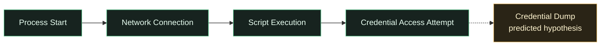
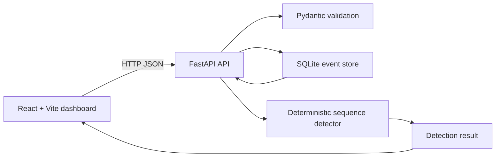

# GHOST — The Almost-Completed Attack Detector

> Infer the likely next stage of an incomplete attack sequence without confusing a hypothesis with observed activity.

GHOST is a local cybersecurity research prototype that analyzes ordered, synthetic security events, identifies missing stages in a deterministic scenario rule, and ranks plausible next actions. It is designed as a transparent investigation aid: predictions are hypotheses supported by observed event IDs, not confirmations that an action occurred.

**Research status:** runnable local prototype · synthetic data only · rule-based detection · not production-hardened

[Architecture](./Architecture.md) · [Security checklist](./SecurityChecklist.md) · [Project memory and validation record](./memory.md)

## Project overview

Investigators may need to reason about what could happen next while an attack sequence is still incomplete. A final event may not yet be visible, may be delayed, or may be outside the available sensor coverage. GHOST explores this problem with a deliberately constrained synthetic scenario:

1. Normalize and order supplied security events by event time, with event IDs as deterministic tie-breakers.
2. Compare the observed event types with the expected stages of the selected scenario.
3. Rank candidate next actions using transparent deterministic weights.
4. Link predictions to the observed event IDs and expose missing stages, alternatives, and timing metadata.
5. Render observed evidence and predicted actions as separate graph node types.

The current implementation is local and uses one deterministic Office macro scenario. It does not ingest live telemetry, run a machine-learning model, or prove that a predicted action took place.

## Research question and objectives

> **Can a system infer and rank plausible next attack stages from incomplete security-event sequences while explicitly preserving the boundary between observed evidence and predicted hypotheses?**

### Implemented objectives

- Process a typed, normalized event contract with timestamps and ingestion metadata.
- Detect the incomplete `scenario-office-macro` sequence.
- Identify duplicate, delayed, and out-of-order input conditions.
- Rank next-action hypotheses with deterministic heuristic confidence values.
- Attach predictions to supporting event IDs and missing expected stages.
- Expose alternative explanations and insufficient-evidence states.
- Present the result through a local FastAPI API and React/Vite dashboard.

### Future research objectives

- Expand the synthetic scenario corpus and define reproducible withheld-stage evaluations.
- Test noisy, duplicated, delayed, out-of-order, ambiguous, and benign sequences at larger scale.
- Improve temporal and graph-based reasoning beyond the current ordered-stage rule.
- Calibrate uncertainty and define principled abstention behavior.
- Add production security controls only as a separately scoped engineering effort.

## Key features

- **Synthetic scenario selection:** the API exposes the `scenario-office-macro` fixture as a `synthetic_demo` scenario with four deterministic demo events.
- **Event normalization:** duplicate IDs are deduplicated for matching; event time and ingestion time are tracked separately.
- **Incomplete-stage detection:** the detector reports observed stages, missing expected stages, completeness, and insufficient evidence.
- **Ranked hypotheses:** `credential_dump` and `persistence_setup` are ranked with deterministic weights. The displayed confidence is a heuristic score, not a calibrated probability.
- **Evidence-linked reasoning:** each prediction includes supporting event IDs, observed stages, missing stages, reasoning, and alternative explanations.
- **Observed-versus-predicted graph:** observed events use `observed_event` nodes; hypotheses use separate `predicted_action` nodes and `supports_prediction` edges.
- **Timeline metadata:** the dashboard shows event time and ingestion-order information, including delayed and out-of-order indicators.
- **Local persistence:** normalized event rows are stored in a local SQLite database. Detection results and investigations are not durably persisted.
- **Validation and safe errors:** Pydantic constraints, bounded request bodies and event batches, restricted local CORS, idempotent event storage, and sanitized client-facing errors are implemented.

## How it works

```text
Synthetic scenario
        ↓
Event normalization and deterministic ordering
        ↓
Expected-stage comparison
        ↓
Candidate next-action ranking
        ↓
Supporting-event and alternative-explanation association
        ↓
Graph, timeline, prediction, and investigation views
```

## Attack-sequence example

The bundled fixture contains four observed stages. `credential_dump` is withheld from the fixture and appears only as a predicted hypothesis.



The solid sequence represents supplied synthetic evidence. The dashed edge and distinct node style represent an inferred possibility. The predicted stage is not an observed event and is not proof that credential dumping occurred.

## Architecture

The repository contains a React/Vite/TypeScript frontend and a FastAPI/Pydantic backend. The backend validates normalized events, seeds deterministic demo events, stores event rows in SQLite, applies the pure sequence detector, and returns predictions plus an evidence graph. The frontend calls the typed API contracts and presents Overview, Attack graph, Event timeline, Predictions, Investigations, Scenarios & tests, and Security & audit views.



Important boundaries:

- `POST /api/detection` evaluates a supplied event batch in memory.
- `POST /api/events` stores one validated event and reports duplicate IDs idempotently.
- Graph output is computed from detection results; it is not stored as a durable investigation record.
- The dashboard displays documented security posture gaps; the Security & audit view is not a server-side audit log.

## Tech stack

The following technologies are declared or used by the project:

- **Python:** FastAPI, Uvicorn, Pydantic, pytest, HTTPX
- **Frontend:** TypeScript, React, React DOM, Vite, `lucide-react`
- **Storage:** SQLite through Python's standard-library `sqlite3` module
- **Interfaces:** JSON over local HTTP; FastAPI's generated OpenAPI documentation

GHOST currently uses deterministic rules and weighted heuristics. It does not claim to implement machine learning or an AI model.

## Dashboard screenshots

No screenshot files are currently present in the repository, so no image links are fabricated here. Capture documentation-safe screenshots from the local application and add them under `docs/screenshots/` if desired:

1. `overview.png` — Overview with the synthetic scenario, event count, observed/missing stages, and API status.
2. `attack-graph.png` — Attack graph showing observed nodes separately from predicted-action nodes, with a node inspector open.
3. `event-timeline.png` — Event timeline showing event timestamps, ingestion information, and any delayed/out-of-order indicators.
4. `predictions.png` — Predictions view showing ranked actions, heuristic confidence, supporting event IDs, reasoning, and alternatives.
5. `investigations.png` — Investigations view showing the selected hypothesis and linked evidence.
6. `scenarios-and-tests.png` — Scenarios & tests view after running detection.
7. `security-and-audit.png` — Security & audit view showing implemented, partial, and not-implemented controls.

Use only the bundled synthetic fixture. Do not include credentials, live telemetry, private host data, or unrelated desktop notifications.

## Installation and local execution

### Prerequisites

- Python 3.11 or later is intended; Python 3.14 was documented as verified for this prototype.
- Node.js 20 or later.
- PowerShell and Git.

### 1. Start the backend

Run these commands from the repository root:

```powershell
cd backend
py -m venv .venv
.\.venv\Scripts\Activate.ps1
py -m pip install -r requirements.txt
cd ..
py -m uvicorn backend.app:app --host 127.0.0.1 --port 8000
```

The API is available at `http://localhost:8000`. Health check: `http://localhost:8000/api/health`. Interactive OpenAPI documentation: `http://localhost:8000/docs`.

The backend defaults to `ghost.db` for local SQLite storage and allows the local Vite origins `http://localhost:5173` and `http://127.0.0.1:5173`. Optional environment variables supported by the implementation are `GHOST_DATABASE_PATH`, `GHOST_FRONTEND_ORIGINS`/`GHOST_FRONTEND_ORIGIN`, and `GHOST_LOG_LEVEL`.

### 2. Start the frontend

Open a second PowerShell window and run from the repository root:

```powershell
cd frontend
npm install
npm run dev
```

Open `http://localhost:5173`. The frontend uses `http://localhost:8000` by default; set `VITE_API_URL` before starting Vite if the API is hosted at another URL.

### 3. Run checks

Run backend tests from the repository root:

```powershell
py -m pytest -q
```

Build the frontend from `frontend/`:

```powershell
cd frontend
npm run build
```

## Demonstration walkthrough

1. Start the backend and frontend using the commands above.
2. Open the dashboard. It loads the available synthetic scenario and its deterministic demo events through the API.
3. Confirm the scenario selector shows **Office macro to credential access** (`scenario-office-macro`).
4. Open **Overview** to review the four supplied events and the incomplete sequence.
5. Open **Scenarios & tests** and run detection. The UI sends the loaded events to `POST /api/detection`.
6. Open **Attack graph**. Select an observed event or predicted-action node to inspect labels and supporting event IDs.
7. Open **Event timeline** to compare event timestamps with ingestion-order metadata.
8. Open **Predictions** to review the ranked `credential_dump` and `persistence_setup` hypotheses, heuristic confidence, reasoning, missing stages, and alternatives.
9. Open **Investigations** to inspect the selected prediction and its linked evidence. This is a client-side view of the current result, not a persisted investigation.
10. Open **Security & audit** to review the prototype's documented control posture.

If the API is unavailable, the dashboard reports an explicit unavailable/error state rather than showing a fabricated successful result.

## Evaluation methodology

Prediction quality should be evaluated against withheld future stages rather than against the heuristic confidence value itself.

For each prediction opportunity:

- Hold out a known future stage from a complete synthetic sequence.
- Provide only the preceding events to the detector.
- Record whether the correct stage appears at rank 1 and at a chosen top-*k* cutoff.
- Count incorrect top-ranked predictions separately from abstentions.
- Report accuracy as correct predictions divided by prediction opportunities.
- Report coverage as non-abstaining opportunities divided by all evaluated opportunities.
- Evaluate complete sequences, insufficient-evidence inputs, duplicate events, delayed events, out-of-order events, ambiguous sequences, and benign lookalikes where the corpus supports them.

The repository's documented local evaluation reported one supported withheld-stage opportunity, one correct top-ranked prediction, two abstention conditions, conditional top-1 accuracy of 1/1, and coverage of 1/3. These are previously reported prototype checks, not a benchmark: the implementation has one scenario, one withheld future stage, deterministic rules, and no production telemetry distribution. They have not been rerun as part of this README edit.

## Testing

The project documentation records the following previous validation:

- `py -m pytest -q`: 10 backend tests passed, with 33 deprecation warnings reported at that time.
- `npm run build` from `frontend/`: TypeScript compilation and Vite production build passed.
- `py -m compileall backend -q`: passed.
- Manual browser validation covered all dashboard views against the local API.

There is no automated frontend/browser test suite in the repository. The results above are historical documentation, not a fresh test run for this README change.

## Security and ethical scope

GHOST is a synthetic-data research prototype, not a production security monitoring platform. It must not be connected to sensitive production telemetry without appropriate authentication, authorization, privacy review, data protection, operational monitoring, and validation.

The current checklist confirms these limitations:

- Authentication, sessions, MFA, authorization/RBAC, and tenant isolation are not implemented.
- Persistent investigations, durable detection-result storage, retention controls, and a structured server-side audit log are not implemented.
- Rate limiting, TLS/deployment hardening, encryption at rest, event signature verification, and production observability are not implemented.
- Input validation, request-size limits, event-batch limits, restricted local CORS, idempotent event storage, and sanitized client errors are implemented or partially implemented as documented.

Do not interpret a ranked hypothesis as an alert verdict, a calibrated probability, or evidence that an action occurred. Use synthetic lab data only.

## Project documentation

- [Architecture.md](./Architecture.md) — component flow, data contracts, detection boundary, API routes, and limitations.
- [SecurityChecklist.md](./SecurityChecklist.md) — implementation status and remaining security gaps.
- [memory.md](./memory.md) — project decisions, validation record, evaluation notes, and unresolved issues.

## Roadmap

### Implemented foundation

- One deterministic synthetic Office macro scenario.
- Typed event ingestion and local SQLite storage.
- Ordered-stage detection with duplicate, delayed, and out-of-order metadata.
- Ranked, evidence-linked hypotheses and graph separation between observed and predicted nodes.
- Local graph-first dashboard and documented security posture.

### Proposed future work

- Broader synthetic scenario corpus and reproducible benchmark fixtures.
- More robust temporal and graph-based reasoning.
- Uncertainty calibration, clearer abstention policies, and analyst feedback loops.
- Additional tests for noisy, delayed, duplicated, out-of-order, ambiguous, and benign sequences.
- Automated browser, property-based, integration, and security tests.
- Production security controls only if the project is separately scoped for deployment.

## Contributions and license

Contributions are welcome when they preserve the synthetic-data boundary, keep observed evidence distinct from hypotheses, include focused tests or documentation, and update the relevant architecture or security record when behavior changes. Please open an issue or pull request describing the research or engineering motivation.

No license has been specified for this repository. Do not assume unrestricted reuse, modification, or redistribution.

---

GHOST is an educational and research prototype for transparent reasoning over incomplete synthetic attack sequences.
