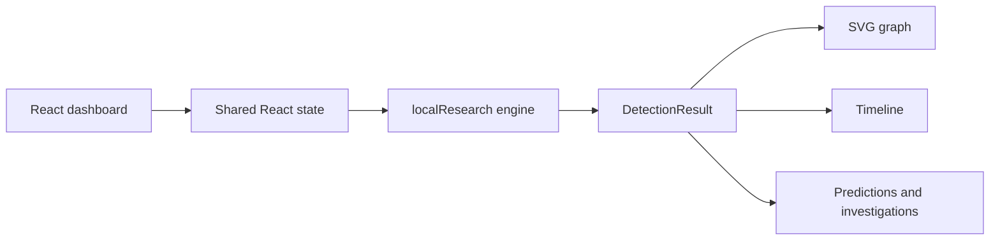

# GHOST — The Almost-Completed Attack Detector

> **FIND WHAT COMES NEXT.** From incomplete events to probable attack paths.

GHOST is a frontend-only cybersecurity research demonstration that reconstructs incomplete, synthetic attack sequences and ranks plausible next actions. The browser runs a deterministic local engine and keeps observed evidence, inferred relationships, and predicted hypotheses visibly separate.

**Status:** React/Vite/TypeScript · offline deterministic fixtures · synthetic data only · not production monitoring

[Architecture](./Architecture.md) · [Security checklist](./SecurityChecklist.md) · [Project memory](./memory.md)

## Research purpose

Investigators may need to assess what could happen next before a sequence is complete. GHOST explores that question without pretending a missing event is proof:

> **Can a system infer and rank plausible next attack stages from incomplete security-event sequences while explicitly preserving the boundary between observed evidence and predicted hypotheses?**

The current demonstration uses two deterministic synthetic scenarios. It does not collect live telemetry, execute attacks, use machine learning, or provide calibrated real-world probabilities.

## What is implemented

- Two synthetic scenario fixtures with consistent event IDs, stage definitions, and results.
- Local event normalization, deterministic ordering, duplicate detection, delayed-arrival metadata, and out-of-order detection.
- Ranked next-action hypotheses with transparent heuristic confidence labels.
- Supporting event IDs, missing stages, reasoning, and alternative explanations.
- Interactive SVG attack graph with observed nodes, inferred edges, and dashed predicted branches.
- Event timeline with event-time versus ingestion-time inspection and delayed filtering.
- Overview, Predictions, Investigations, Scenarios & Tests, and Security & Audit views.
- Deterministic reset/replay behavior with no network request or backend dependency.

### Evidence categories

| Category | Meaning |
|---|---|
| **Observed** | Directly represented in a supplied synthetic fixture. |
| **Inferred** | A relationship or interpretation derived from available fixture evidence. |
| **Predicted** | A possible next action; not confirmed activity. |

Heuristic confidence is not a calibrated probability. A missing event does not prove that the action occurred.

## How it works

```text
Scenario fixture → local normalization → stage comparison
→ deterministic candidate ranking → evidence-linked result
→ graph, timeline, prediction, and investigation views
```


The solid path is supplied synthetic evidence. The dashed branch is a hypothesis generated from that evidence.

## Architecture

The application is a single Vite frontend:



The engine and fixtures live in [`frontend/src/api.ts`](./frontend/src/api.ts). UI state and views live in [`frontend/src/Dashboard.tsx`](./frontend/src/Dashboard.tsx), and the TRACE LAB design system is in [`frontend/src/styles.css`](./frontend/src/styles.css).

## Tech stack

- TypeScript
- React and React DOM
- Vite
- `lucide-react`
- SVG for the interactive graph

No FastAPI, Python runtime, SQLite database, external API, authentication service, or hosted inference service is required at runtime.

## Screenshots

The following screenshots were captured from the local Vite application using the bundled synthetic fixtures:

| View | Screenshot |
|---|---|
| Overview | [overview.png](./docs/screenshots/overview.png) |
| Attack Graph | [attack-graph.png](./docs/screenshots/attack-graph.png) |
| Event Timeline | [event-timeline.png](./docs/screenshots/event-timeline.png) |
| Predictions | [predictions.png](./docs/screenshots/predictions.png) |
| Investigations | [investigations.png](./docs/screenshots/investigations.png) |
| Scenarios & Tests | [scenarios-and-tests.png](./docs/screenshots/scenarios-and-tests.png) |
| Security & Audit | [security-and-audit.png](./docs/screenshots/security-and-audit.png) |

Use only the bundled synthetic fixtures. Do not include credentials, private telemetry, or desktop notifications in future captures.

## Installation and local execution

### Prerequisites

- Node.js 20 or later.
- PowerShell and Git.

From the repository root:

```powershell
cd frontend
npm install
npm run dev
```

Open the Vite URL shown in the terminal, normally `http://localhost:5173`.

Create a production build from `frontend/`:

```powershell
npm run build
```

The build runs TypeScript compilation and Vite bundling. The frontend has no backend startup command and makes no request to `localhost:8000`.

## Demonstration walkthrough

1. Start Vite and open the local dashboard.
2. Confirm the active fixture selector shows **Office macro to credential access**.
3. Review Overview metrics for observed events, missing stages, hypotheses, and heuristic confidence.
4. Open **Attack Graph** and select observed or predicted nodes to inspect their evidence boundary.
5. Open **Event Timeline** and switch between all and delayed events.
6. Open **Predictions** to inspect ranked actions, supporting IDs, reasoning, missing stages, and alternatives.
7. Open **Investigations** to inspect the selected hypothesis. This is frontend session state, not durable persistence.
8. Open **Scenarios & Tests**, switch to **Build runner persistence drift**, run detection, and reset the fixture.
9. Open **Security & Audit** to review the honest frontend-only posture.

Scenario switching recomputes every view from the selected deterministic fixture.

## Evaluation methodology

Evaluate against withheld future stages rather than heuristic scores:

- Hold out a known future stage from a complete synthetic sequence.
- Run the detector on preceding events only.
- Record top-1 and top-*k* correctness, incorrect predictions, and abstentions.
- Report accuracy as correct predictions divided by prediction opportunities.
- Report coverage as non-abstaining opportunities divided by all opportunities.
- Include complete, insufficient-evidence, duplicated, delayed, out-of-order, ambiguous, and benign lookalike fixtures when supported.

No comprehensive benchmark has been established for this frontend demonstration.

## Security and ethical scope

This is not a production security monitoring platform. Frontend-only code does not provide authentication, authorization/RBAC, MFA, tenant isolation, secure ingestion, durable investigations, retention, encrypted storage, or server-side audit logging. The Security & Audit view is a posture explanation, not an audit stream.

Do not connect the demo to sensitive production telemetry. Any future deployment would require a separately designed authenticated service, privacy review, access controls, retention policy, validation, monitoring, and incident response.

## Roadmap

- Broader synthetic scenario corpus and reproducible benchmarks.
- More robust temporal and graph-based reasoning.
- Uncertainty calibration and principled abstention.
- Automated component, browser, property, and security tests.
- Documentation screenshots captured from the real local interface.
- Production controls only as a separately scoped architecture.

## Contributions and license

Contributions should preserve the synthetic-data boundary, evidence distinction, deterministic replay, and honest limitations. Include focused tests or documentation with behavior changes.

No license has been specified for this repository. Do not assume unrestricted reuse or redistribution.

---

GHOST is an educational research instrument for transparent reasoning over incomplete synthetic attack sequences.
